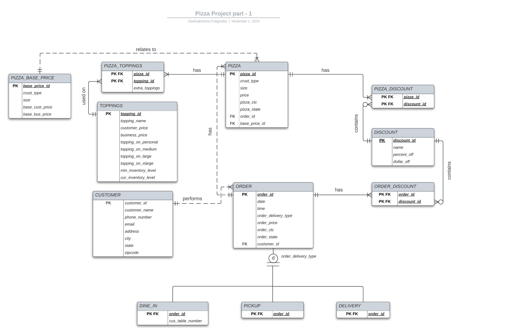

# CPSC-6620 Pizza Restaurant Database Management System

A comprehensive database management system for a pizza restaurant, developed as part of CPSC-6620 coursework. This project implements a complete relational database solution for managing pizza orders, customers, inventory, and business operations using Java, AWS RDS(MySQL)

## Entity Relationship Diagram

The ERD shows the complete database schema including relationships between customers, orders, pizzas, toppings, and discount systems.

